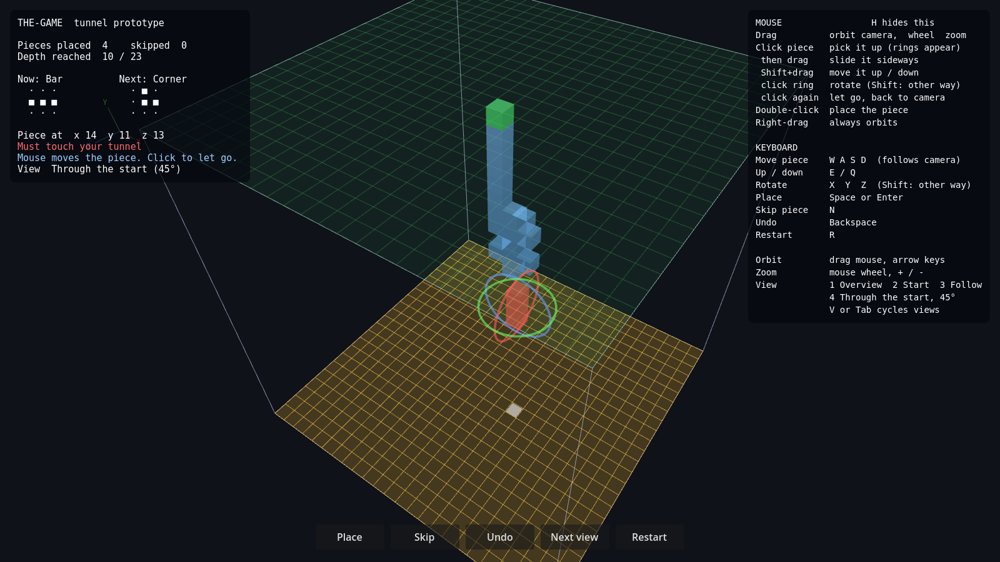

# THE-GAME

A 3D tunnel-building puzzle. The play area is a cube made of small cells.
You start in the centre of the top face of a 24x24x24 cube and must dig a tunnel to the bottom
face using flat pieces (up to 3x3 cells). Each new piece must touch your
tunnel somewhere. Later, several players will dig crossing tunnels and block
each other.



## Run the prototype

You only need Godot. It's free, about 100 MB, and needs no installer.

1. Go to <https://godotengine.org/download> and download **Godot 4** for your
   computer. Pick the normal version, not the ".NET" one.
   - **Mac:** open the downloaded `.zip`, drag **Godot** into Applications,
     then open it. If macOS says it can't check the app, right-click it and
     choose **Open**.
   - **Windows:** unzip the download and double-click `Godot_v4...exe`.
2. Get this repository onto your computer. Easiest: on GitHub click the green
   **Code** button, then **Download ZIP**, and unzip it. (Or `git clone` it.)
3. In Godot's Project Manager click **Import**, select the `project.godot`
   file in the unzipped folder, then click **Import & Edit**.
   (If Godot offers to convert or upgrade the project, say yes.)
4. Press **F5** (Mac: **Cmd+B**), or click the ▶ play button in the top right.
   The game opens in a new window.

To stop the game, close its window or press **F8** in the editor.

The game opens maximized. Newer Godot versions (4.4 and later) may run it
inside the editor's **Game** tab instead. For a separate window, open the
Game tab's **⋮** menu and turn off embedding.

## Controls

### Mouse

The mouse controls the camera until you click the piece. Then it controls the
piece until you click again.

| What | How |
| --- | --- |
| Orbit the camera | Drag with the mouse. Right-drag always orbits, even while you hold a piece. Two-finger scroll on a trackpad also works. |
| Zoom | Mouse wheel, or pinch on a trackpad |
| Pick up the piece | Click it. Three coloured rings appear around it. |
| Slide it sideways | Drag anywhere while it is picked up |
| Move it up / down | **Shift** + drag |
| Rotate it | Click a ring: red turns around X, green around Y (vertical), blue around Z. **Shift**-click turns the other way. |
| Let go | Click again (without dragging). The mouse controls the camera again. |
| Place it | Double-click the piece, or the **Place** button |

The buttons at the bottom (Place, Skip, Undo, Next view, Restart) do the same
as the keys below.

### Keyboard

| What | Keys |
| --- | --- |
| Move the piece | **W A S D** (moves relative to where the camera looks) |
| Move up / down | **E** / **Q** (or Page Up / Page Down) |
| Rotate the piece | **X**, **Y**, **Z** turn it around that axis. Hold **Shift** to turn the other way. |
| Place the piece | **Space** or **Enter** |
| Skip this piece | **N** (you get the "next" piece and a new random one) |
| Undo last piece | **Backspace** |
| Restart | **R** |
| Let go of the piece | **Esc** |
| Orbit / zoom | **Arrow keys** / **+** and **-** |
| View mode | **1** Overview (whole cube), **2** Start, **3** Follow piece, **4** Through the start at 45° (default; looks through the start face towards the goal face, with a see-through tunnel). **V** or **Tab** cycles. |
| Show / hide help | **H** |

The keys are read by their letter, so on a Swiss/German keyboard **Y** and
**Z** are the keys labelled Y and Z.

## How it plays

- The ghost piece is **green** when it can be placed and **red** when it can't.
  The panel on the left says why (outside the cube, overlapping, or not
  touching the tunnel).
- A piece may touch **any** part of your tunnel, not only the last piece.
- A faint shadow on the gold goal face shows where the piece is above it.
- You win as soon as any cell of the tunnel reaches the bottom (gold) face.

## Changing the setup

Open `scenes/main.tscn` in Godot and click the **Main** node. In the
Inspector on the right you can change:

- **Grid Size**: the cube size in cells (default 24 x 24 x 24).
- **Piece Sizes**: which piece sizes are dealt, by number of cells
  (default 3, 4 and 5). Set it to just `4` and every piece has 4 cells.

The piece shapes themselves are listed in `scripts/pieces.gd`.

## Code layout

| File | What it does |
| --- | --- |
| `scripts/grid.gd` | The cube of cells and who owns each cell. |
| `scripts/player.gd` | A player's start cell, goal face and digging direction. |
| `scripts/game_state.gd` | The rules: valid placement, placing, undo, win check. No drawing. |
| `scripts/pieces.gd` | The list of flat piece shapes. |
| `scripts/piece.gd` | The piece being moved: position and 90° rotations. |
| `scripts/orbit_camera.gd` | Orbit camera and view modes. |
| `scripts/cell_mesh.gd` | Draws a group of cells as one solid shape (outside faces only). |
| `scripts/main.gd` | Builds the scene, reads keyboard and mouse, draws the HUD. |

The rules already store an owner for every cell and give each player their
own start and goal face, so multiplayer (crossing tunnels that block each
other) can be added on top without changing them.

## Tests

From the project folder, with Godot on your PATH:

```
godot --headless --import
godot --headless -s tests/test_rules.gd
godot --headless -s tests/smoke_test.gd
```

The first checks the rules, the second loads the real game and drives it with
key presses.
